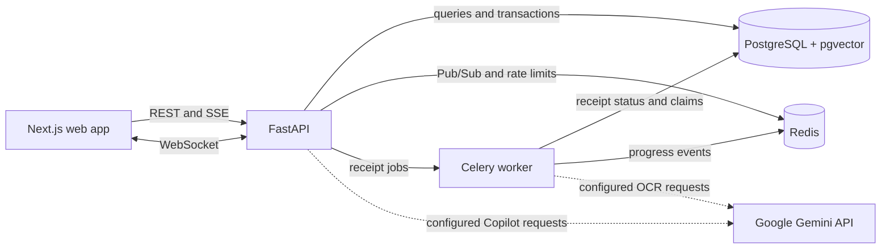

# SplitSmart AI ⚡🧾

> **Next-generation, real-time multiplayer receipt-splitting, expense ledger, and AI financial copilot engine.**  
> Eliminates manual typing, off-by-one rounding errors, and convoluted IOU webs through vision models, integer arithmetic, and graph theory.

[](https://fastapi.tiangolo.com)
[](https://nextjs.org)
[](https://www.postgresql.org)
[](https://redis.io)
[](https://www.python.org)
[](LICENSE)
[]()

---

## 📌 Executive Summary

Splitting group bills today is broken. Traditional tools like Splitwise require tedious manual item entry, suffer from floating-point rounding errors on shared discounts and taxes, and fail to handle real-time party bills without requiring everyone to sign up and download an app.

**SplitSmart AI** solves this with 4 core engineering innovations:
1. **Zero-Typing Vision AI Pipeline:** Upload a photo of any crumpled bill or receipt; Google Gemini 2.0 Flash extracts line items, quantities, taxes, and service fees asynchronously via Celery and streams progress via Server-Sent Events (SSE).
2. **No-Login Multiplayer Claim Rooms:** Share a short link or QR code. Roommates and friends join instantly as guests via scoped JWTs, claim their items live over Redis-backed WebSockets, and watch totals update in real time.
3. **Exact Paise/Cent Integer Arithmetic (Zero-Leak Guarantee):** Zero floating-point representation in the database. All amounts are stored as `BIGINT` minor units (paise/cents). Tax and discounts are distributed proportionally using the **Hare-Niemeyer Largest Remainder Method**, ensuring $\sum \text{Member Shares} \equiv \text{Bill Total}$ down to the last paise.
4. **Min-Cash-Flow Debt Simplification ($O(N \log N)$):** Multi-day trips often create tangled webs of pairwise debts (e.g. 11 transactions between 5 friends). Our dual max-heap min-cash-flow algorithm collapses this into the minimum possible transactions (e.g. 4 payments), complete with **NPCI-compliant UPI deep links** and QR codes.

---

## 🏛️ System Architecture

```
                    ┌────────────────────────────────────────────────────────┐
                    │                  Next.js 15 Client                     │
                    │      (App Router, Tailwind CSS, TypeScript, SSE, WS)   │
                    └───────────────────┬───────────────────┬────────────────┘
                                        │                   │
                        REST / SSE (HTTP/2)       WebSockets (Bidirectional)
                                        │                   │
                                        ▼                   ▼
┌────────────────────────────────────────────────────────────────────────────┐
│                              FastAPI Backend                               │
│                                                                            │
│  ┌───────────────────────┐  ┌──────────────────────┐  ┌─────────────────┐  │
│  │ Vision Receipt Router │  │  Group & Ledger API  │  │  WebSocket Hub  │  │
│  └──────────┬────────────┘  └──────────┬───────────┘  └────────┬────────┘  │
│             │                          │                       │           │
│             │ Dispatches Jobs          │ Queries / Mutations   │ Pub/Sub   │
│             ▼                          ▼                       ▼           │
│  ┌──────────────────────┐   ┌──────────────────────┐  ┌─────────────────┐  │
│  │   Celery Workers     │   │ SQLAlchemy 2 (Async) │  │ Redis 7 Broker  │  │
│  │ (Gemini 2.0 Vision)  │   │  asyncpg Connection  │  │   & Pub/Sub     │  │
│  └──────────────────────┘   └──────────┬───────────┘  └─────────────────┘  │
└────────────────────────────────────────┼───────────────────────────────────┘
                                         ▼
                 ┌───────────────────────────────────────────────┐
                 │       PostgreSQL 16 Database + pgvector       │
                 │   - 100% BIGINT minor units (paise/cents)     │
                 │   - ACID ledger entries with idempotency keys │
                 │   - Vector embeddings for semantic search     │
                 └───────────────────────────────────────────────┘
```



---

## 💡 Core Algorithms & Financial Engineering

### 1. Mathematical Engine & Paise Invariant
When calculating individual splits from receipts with mixed shared items, platform fees, taxes (GST), and coupon discounts:
- **Item Claims:** Users can claim items in whole or partial fractions (e.g. $1/3$ of a dish). Each user's item share is calculated using integer division: $\lfloor P / k \rfloor$.
- **Discounts & Surcharges:** Any bill-level taxes, service charges, delivery fees, and discounts are distributed proportionally based on each claimant's subtotal share:
  $$A_u = \left\lfloor (E - D) \times \frac{S_u}{S} \right\rfloor$$
- **Largest Remainder Allocation:** The difference $R = T - \sum(S_u + A_u)$ is sorted by highest fractional remainder and distributed $1\text{ paise}$ at a time until exhausted.
- **Invariant:** $\sum_{u} \text{final\_share}_u = \text{receipt.total\_amount\_paise}$ **always**.

### 2. Min-Cash-Flow Debt Simplification Algorithm
For any group of $N$ users with mutual debts:
1. Compute the net balance for each user:
   $$\text{Balance}(u) = \sum \text{received} - \sum \text{spent}$$
2. Assert the **Zero-Sum Invariant**: $\sum_{u} \text{Balance}(u) \equiv 0$.
3. Separate users into two priority heaps:
   - **Debtors** (users with $\text{Balance} < 0$)
   - **Creditors** (users with $\text{Balance} > 0$)
4. Greedily match the largest debtor with the largest creditor, settling $\min(|B_{\text{debtor}}|, B_{\text{creditor}})$, push remaining balances back onto the heaps, and repeat until all balances are zero.
5. **Result:** Reduces worst-case $O(N^2)$ pairwise debts to at most $N-1$ optimal settlements.

### 3. Native Indian Fintech / UPI Deep Links
Every simplified settlement generates an NPCI-standard UPI intent link:
```
upi://pay?pa=friend@oksbi&pn=Priya%20Sharma&am=1240.00&cu=INR&tn=SplitSmart%20Goa%20Trip
```
and produces an inline base64 QR code ready for instant scanning with Google Pay, PhonePe, Paytm, or CRED.

---

## 📂 Repository Structure

```
SplitSmart-AI/
├── SPEC.md                    # Complete technical specification & schema design
├── TASKS.md                   # Granular stage-by-stage implementation tracker
├── docker-compose.yml         # Multi-container dev environment (Postgres 16 + Redis 7)
├── .env.example               # Environment variables template
├── apps/
│   ├── api/                   # FastAPI Backend
│   │   ├── alembic/           # Async database migrations
│   │   ├── app/
│   │   │   ├── main.py        # Application entrypoint & middleware
│   │   │   ├── config.py      # Pydantic v2 Settings management
│   │   │   ├── database.py    # AsyncEngine + session maker
│   │   │   ├── models/        # SQLAlchemy 2.0 ORM Declarative Models
│   │   │   │   ├── user.py
│   │   │   │   ├── group.py
│   │   │   │   ├── group_member.py
│   │   │   │   ├── receipt.py
│   │   │   │   ├── receipt_line_item.py
│   │   │   │   ├── item_claim.py
│   │   │   │   └── ledger_entry.py
│   │   │   ├── schemas/       # Pydantic validation & response schemas
│   │   │   ├── services/      # Pure business logic & algorithms
│   │   │   │   ├── math_engine.py      # Proportional split + paise invariant
│   │   │   │   ├── debt_simplifier.py  # Min-Cash-Flow graph solver
│   │   │   │   ├── upi_generator.py    # UPI URI & QR generator
│   │   │   │   └── sandbox.py          # 1-Click recruiter dataset seeder
│   │   │   └── api/v1/        # REST & WebSocket routers
│   │   │       ├── health.py
│   │   │       ├── groups.py
│   │   │       ├── ledger.py
│   │   │       └── sandbox.py
│   │   └── tests/             # Automated test suite
│   │       ├── test_math_engine.py
│   │       ├── test_debt_simplifier.py
│   │       └── test_stage1_health.py
│   └── web/                   # Next.js 15 Frontend
│       ├── src/
│       │   ├── app/           # App Router pages
│       │   └── lib/           # Typed API clients & currency utilities
│       ├── package.json
│       └── tailwind.config.ts
```

---

## ⚡ Quickstart Guide

### One-command local stack

Prerequisite: Docker Desktop (or Docker Engine with Docker Compose v2). From the repository root:

```bash
git clone https://github.com/JanavGandhi/SplitSmart-AI.git
cd SplitSmart-AI
docker compose up --build
```

Open the web app at [http://localhost:3000](http://localhost:3000), API docs at [http://localhost:8000/api/docs](http://localhost:8000/api/docs), and health status at [http://localhost:8000/api/v1/health](http://localhost:8000/api/v1/health). The Compose stack runs PostgreSQL, Redis, FastAPI, the Celery worker, and Next.js; the API applies Alembic migrations during startup.

To enable live Gemini OCR and Copilot responses, set `GEMINI_API_KEY` in your shell or a root `.env` file before starting. Without the key, OCR uses its configured mock mode and Copilot returns an explicit `503`. Copilot questions and a minimal group summary (member names, balances, and recent receipt totals) are sent to Google Gemini when configured. Do not use the development Compose defaults in production.

Stop the stack with `docker compose down`; add `-v` only if you intend to delete its database, Redis, and uploaded-receipt data.

### Manual development setup

For hot-reloading, start PostgreSQL and Redis with `docker compose up -d postgres redis`, then run the backend and frontend in separate terminals:

```bash
cd apps/api
python -m venv .venv

# On Windows:
.venv\Scripts\activate
# On macOS/Linux:
# source .venv/bin/activate

pip install -e ".[dev]"
alembic upgrade head
uvicorn app.main:app --reload --host 0.0.0.0 --port 8000
```

```bash
cd apps/web
npm install
npm run dev
```

---

## 🧪 1-Click Recruiter Sandbox & Interactive Demo

Want to see SplitSmart AI's debt graph simplification in action without creating groups or typing expenses manually?

Hit the sandbox seeder endpoint:
```bash
curl -X POST http://localhost:8000/api/v1/sandbox/init
```

This instantly creates the **"Goa Weekend Squad"** scenario:
- **5 Members:** Aryan, Priya, Karan, Meera, and Dev.
- **4 Real Bills:**
  1. *Fisherman's Wharf Seafood Dinner* (12 items, ₹6,450.00)
  2. *Blinkit Midnight Snacks Haul* (₹1,280.00)
  3. *Curlies Beach Shack Sundowner* (₹3,750.00)
  4. *Airport Innova Taxi Ride* (₹2,200.00)
- **Automatic Graph Simplification:** 11 raw cross-debts are collapsed down to **4 clean UPI settlements** with zero rupee discrepancies.

---

## 🔬 Testing & Mathematical Verification

Run the complete backend test suite and lint checks:
```bash
cd apps/api
pytest -q
ruff check app tests
```

### Verified Test Highlights:
- **100 Randomized Permutation Tests:** Generates 100 receipts with random totals, multiple claimants, arbitrary GST, delivery fees, and discounts. Verifies that the sum of claimant portions matches the receipt total with **0 paise deviation**.
- **Min-Cash-Flow Invariant Tests:** Verifies circular debt elimination (e.g. $A \to B \to C \to A$), complex multi-debtor graph convergence, and balance preservation across all participants.
- **183 Tests Passing.**
- **Ruff:** full backend application and test suite passes.

---

## 🗺️ Project Roadmap & Milestones

| Stage | Milestone | Status | Details |
|---|---|:---:|---|
| **Stage 1** | Monorepo Scaffolding, Docker & Database Layer | 🟢 Completed | PostgreSQL 16 (pgvector), Redis 7, SQLAlchemy 2 Async, Alembic migrations, Next.js 15 scaffold. |
| **Stage 2** | Core Math Engine, Debt Simplifier & Sandbox | 🟢 Completed | Largest Remainder Method, Min-Cash-Flow algorithm, UPI QR codes, 1-Click Goa Squad sandbox seeder. |
| **Stage 3** | Async Vision AI Receipt Pipeline & SSE | 🟢 Completed | Gemini 2.0 Flash OCR, Celery asynchronous processing queue, live Server-Sent Events progress tracking. |
| **Stage 4** | Multiplayer No-Login WebSocket Claim Room | 🟢 Completed | Room-scoped guest JWTs, Redis Pub/Sub claims, paise recalculation, roommate simulator, and idempotent ledger finalization. |
| **Stage 5** | Next.js UI & Interactive Graphs | 🟡 Implemented | Dashboard, live claim room, group debt graph, UPI payment flow, and metrics. The live walkthrough needs the Docker Compose stack and a configured Gemini key for Copilot. |
| **Stage 6** | CI/CD & Production Readiness | 🟡 Implemented | Redis sliding-window limits, GitHub Actions checks, and one-command Docker Compose stack. Deployment-specific hardening remains out of scope. |

### Stage 4 room API

- `POST /api/v1/rooms/{room_code}/guest-join` creates a guest membership and returns a room-scoped JWT.
- Connect to `WS /api/v1/rooms/{room_code}/ws?token={access_token}` for participant and claim events.
- Send `{"event":"ITEM_CLAIM_TOGGLED","item_id":"<line-item-uuid>"}` to toggle an item claim, or `{"event":"SIMULATE_FRIENDS"}` to add three demo participants.
- `POST /api/v1/rooms/{room_code}/finalize` requires the guest JWT as a Bearer token and JSON containing `payer_user_id` and `idempotency_key`. All line items must be claimed before finalization.
- Apply the finalization idempotency column with `alembic upgrade head` from `apps/api`.

### Stage 5 API integrations

- `GET /api/v1/groups/{group_id}/receipts` loads the group's receipts and claim data.
- `POST /api/v1/ledger/upi-intent` returns a UPI URI and an inline SVG QR code. Recording a settlement does not verify a bank transfer.
- `GET /api/v1/metrics` returns database-derived counts.
- `POST /api/v1/copilot/chat` uses Gemini with a minimal group summary when `GEMINI_API_KEY` is configured; it returns HTTP 503 when no key is set.
- The Copilot drawer discloses that the user’s question and group summary are sent to Google Gemini.
- Copilot requests are limited to 10/minute per IP, and receipt uploads to 20/hour per IP. Redis must be available; requests fail closed if it is not.

The Stage 5 pages are `/dashboard`, `/groups/{id}`, `/room/{code}`, and `/metrics`. A complete live walkthrough needs the API, PostgreSQL, and Redis running.

---

## 📄 License
This project is licensed under the MIT License. See [LICENSE](LICENSE) for details.
